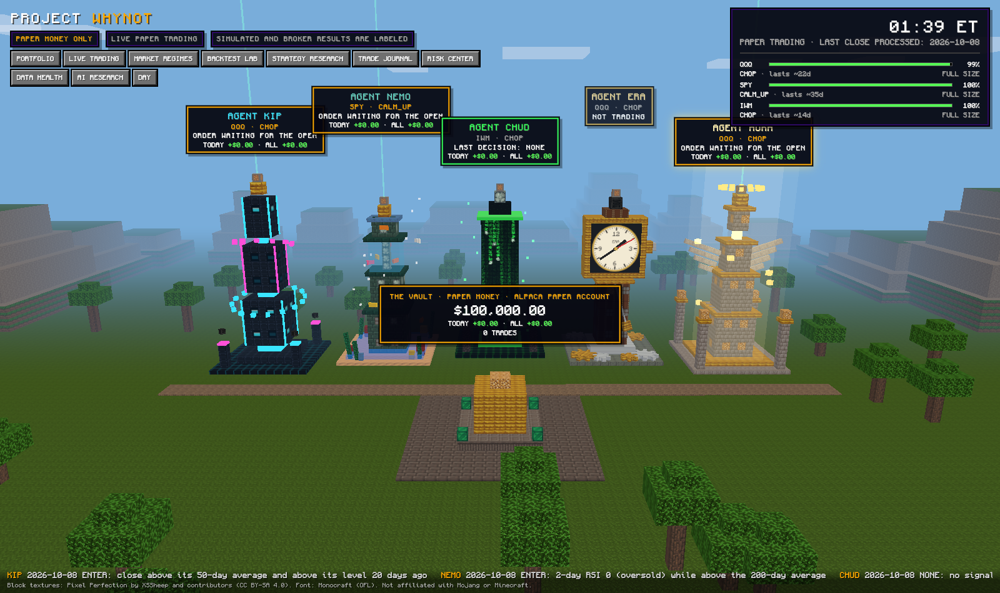

# Project WHYNOT (lite)

A paper-trading research framework for QQQ, SPY and IWM options: five agents, a Hidden
Markov regime model, one central risk engine, and a 3D city that shows what they are doing.



It was built to answer one question honestly: **is there a reproducible edge here, and
does it hold on data the strategy has never seen?** So far the answer is no, and the
system is built to say so. That is the part I am proudest of.

## Why this is a "lite" version

I run the full project privately. That copy holds my working history, my account, my
logs, my downloaded market data and the complete working specification I wrote for it.
None of that belongs on the internet, and the market data is not mine to redistribute.

But the framework is worth showing: the rules, the structure, the tests, the visuals and
the results as they actually came out. This repository is that part. It is the same code
that runs privately, published as a clean snapshot, with nothing personal in it.

What is here and what is not:

| Included | Kept private |
|---|---|
| All source code and the 159 tests | The market data and trade databases |
| The 3D dashboard and replay | Account details, keys and logs |
| The playbooks for every agent and market state | Day-to-day reports and backups |
| My reasoning and the rules the system must obey | The full working specification and build history |
| The results, including the unflattering ones | |

## How it was made

I wrote the specification, set the rules and made every decision. Claude Opus 5.5 did the
research, coding and auditing under that specification, pausing for my approval at the
points the rules require. The skill on show here is the framework: deciding what the
system may and may not do, and holding it to that.

- My thinking: [docs/THINKING.md](docs/THINKING.md)
- The rules: [docs/GUIDELINES.md](docs/GUIDELINES.md)
- Why it is not ready for real money: [docs/FINAL_CHECK.md](docs/FINAL_CHECK.md)

## The five agents

| Agent | Tower theme | Trades | Starting idea |
|---|---|---|---|
| Kip | Futuristic | QQQ | Momentum and trend following |
| Nemo | Ocean | SPY | Mean reversion |
| Chud | Matrix | IWM | Volatility and regime changes |
| Era | Wrist watch | QQQ, then single stocks | Intraday opening range; later a news wild card (rejected, see below) |
| Aura | Glowing, godly | QQQ | Adaptive strategy research |

These are starting hypotheses, not proven strategies. All five answer to one risk engine.

## Results so far

No strategy has passed the acceptance gates (Sharpe above 1.5, drawdown under 15%, hit
rate above 55%, t-statistic above 2.0, and beating both buy-and-hold and the best static
strategy after costs).

Signals on the funds' shares, development period (2006 to 2019; Era 2016 to 2019):

| Agent | Total return | Note |
|---|---|---|
| Kip | +46.7% | Sharpe 0.41 |
| Nemo | +54.5% | Sharpe 0.47 |
| Chud | −23.5% | |
| Era | −18.7% | |
| Aura | +27.1% | |

- The regime model lowered returns compared with the same rules without it.
- The one year with real option prices (2024) made +0.9% on $100,000 over 55 trades, and
  turns negative if the assumed trading cost is doubled.
- The first research cycles proposed two challengers. Both were rejected on development
  data, so validation data was never opened for them.
- Era was retried as a wild card: each day, the stock that is suddenly in the news (at
  least 5 headlines and 3 times its own usual number) and moved at least 2%, followed for
  3 sessions. On about 500 trades from 2016 to 2019 it averaged +0.05% a trade (t 0.22) and
  failed 6 of the 11 screens. Picking by news beat picking the day's biggest mover
  (−58.7%), but neither beat holding SPY (+62.5%). It was rejected and Era stays off.
- The locked holdout period has been looked at zero times.
- Four agents are paper trading at the smallest size to collect forward evidence. The first
  week was a losing one, which on a handful of trades says nothing either way.

Caveats: historical option bid and ask prices were not available, so backtest fills use
real traded prices plus an assumed cost, and implied volatility and Greeks are derived.

## How it is put together

Three layers that never overlap: the AI researches and advises, the regime model reports
probabilities, and plain code decides. No model can override a limit.

```
whynot/ingest/       point-in-time data catalog, downloads, validation, timestamped headlines
whynot/regime.py     the Hidden Markov model: fit, refit, forward filter
whynot/walkforward.py  the regime model walked through time
whynot/switching.py  the six switching rules        whynot/sizing.py  position sizing
whynot/partitions.py the chronological split and the locked holdout
whynot/sim/          agents, playbooks, daily, intraday and news wild-card engines, statistics
whynot/opt/          option pricing, contract selection, fills
whynot/riskengine.py the central limits and kill switch
whynot/researchlab/  research memory, limits, screens, champion against challenger
whynot/live/         lifecycle, brokers, paper-trading steps, reconciliation
whynot/dash/         read-only dashboard server      frontend/  the city
whynot/ops/          alerts, backups, health checks, daily report, stress replays
```

## Run it

You need Python 3.11 or newer and a free Alpaca account for paper-trading API keys.

```bash
python3 -m venv .venv && .venv/bin/pip install -e ".[dev]"
.venv/bin/pytest                      # 153 run with no keys or data; 6 stress replays need the download
cp .env.example .env                  # then paste your own Alpaca paper keys
.venv/bin/whynot data ingest          # downloads the history (large)
.venv/bin/whynot dash                 # http://127.0.0.1:8090
```

## Please read

- **This is not financial advice,** and nothing here is a recommendation to trade.
- **Paper money only.** The code refuses any endpoint other than Alpaca's paper one.
  There is no real-money trading in it and I do not support adding it.
- **No license is attached yet.** You are welcome to read it, run it and learn from it.
  Please ask before reusing it in your own project.

## Credits

Block textures: Pixel Perfection by XSSheep and contributors (CC BY-SA 4.0). Font:
Monocraft (OFL). See `frontend/vendor/ATTRIBUTION.md`. Not affiliated with Mojang or
Minecraft. Market data in the private copy comes from Alpaca, Yahoo and FRED.
